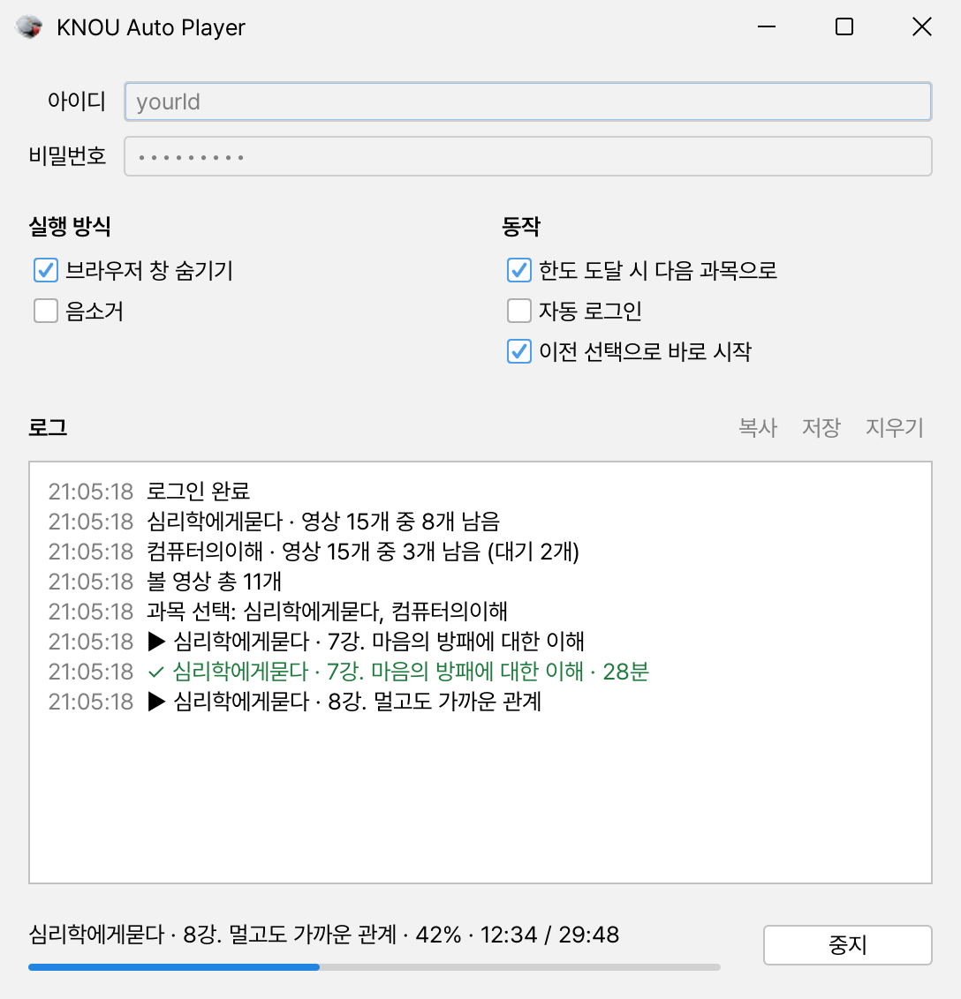

# KNOU Auto Player - JAVA

방송통신대학교(KNOU) 강의 영상 자동 재생기

<p align="center">
  
</p>

같이 방통대 다니는 친구들이 파이썬 설치 없이 쓸 수 있도록
Aiden Lee님의 [knou-auto-player](https://github.com/leegeunhyeok/knou-auto-player)를 Java Swing으로 포팅했습니다.

## 주요 기능

- 선택한 과목의 아직 안 본 강의 영상을 차례로 재생
- 일일 수강 한도에 도달하면 다음 과목으로 넘기기
- 수강 과목 선택, 선택한 과목 기억
- 연습문제 자동 제출 (정답 여부와 상관없이 무작위로 선택)
- 자동 로그인 (비밀번호는 OS 자격 증명 저장소에 보관)
- 브라우저 창 숨기기, 음소거
- 로그 복사·저장

## 설치

[Releases](../../releases)에서 OS에 맞는 파일을 내려받으세요.
Java 런타임이 포함되어 있어 JDK 설치 없이 실행됩니다. **Chrome은 설치되어 있어야 합니다.**

| OS | 파일 |
| --- | --- |
| Windows (x64) | `KNOUAuto-x.x.x.msi` |
| Windows 포터블 (설치 없음) | `KNOUAuto-x.x.x-windows-portable.zip` |
| macOS Apple Silicon (M1 이후) | `KNOUAuto-x.x.x-macos-arm64.dmg` |
| macOS Intel | `KNOUAuto-x.x.x-macos-x64.dmg` |

### Windows

`.msi`를 실행하면 설치됩니다. 설치 후 시작 메뉴나 바탕화면 바로가기로 실행하세요.

설치 없이 쓰려면 `-windows-portable.zip`을 원하는 곳에 압축 풀고 `KNOU Auto Player` 폴더의 `KNOU Auto Player.exe`를 실행하세요.

- 관리자 권한이 필요 없고, 폴더째 옮겨도 됩니다.
- 설정과 자동 로그인 정보는 앱 폴더가 아니라 사용자 계정에 저장됩니다. (설치판과 같은 설정을 함께 씀)

서명되지 않은 파일이라 처음 실행 시 Windows SmartScreen 경고가 뜹니다. `추가 정보 > 실행`을 누르면 됩니다.

### macOS

`.dmg`를 열어 앱을 `Applications`로 끌어다 놓으면 설치됩니다.

서명되지 않은 앱이라 처음 실행 시 "확인되지 않은 개발자" 경고로 열리지 않습니다.
`시스템 설정 > 개인정보 보호 및 보안`에서 `그래도 열기`를 누르거나, 터미널에서 아래 명령을 실행하세요.

```bash
xattr -dr com.apple.quarantine "/Applications/KNOU Auto Player.app"
```

## 사용법

1. 아이디와 비밀번호를 입력하고 `시작`을 누릅니다.
2. 강의 목록을 불러오면 과목 선택 창에서 들을 과목을 고릅니다.
3. 진행 상황은 아래 상태 줄과 로그에 표시됩니다. `중지`를 누르면 멈춥니다.

| 옵션 | 설명 |
| --- | --- |
| 브라우저 창 숨기기 | Chrome 창을 띄우지 않고 백그라운드에서 실행합니다. |
| 음소거 | 영상 소리를 끕니다. |
| 한도 도달 시 다음 과목으로 | 일일 수강 한도에 도달하면 다음 과목으로 넘어갑니다. 끄면 그 자리에서 종료합니다. |
| 자동 로그인 | 로그인에 성공하면 정보를 저장하고, 다음 실행 시 바로 시작합니다. (아래 참고) |
| 이전 선택으로 바로 시작 | 기억된 과목으로 과목 선택 창 없이 바로 시작합니다. |

### 자동 로그인

`자동 로그인`을 체크하고 `시작`을 누르면, 로그인에 성공했을 때 아이디/비밀번호와 실행 옵션을 저장하고 다음 실행 시 바로 시작합니다.

- 비밀번호는 OS 자격 증명 저장소에 저장됩니다. (Windows: 자격 증명 관리자, macOS: 키체인)
- 체크를 해제하면 저장된 정보가 바로 삭제됩니다.
- 저장된 아이디/비밀번호로 로그인에 실패하면 저장된 정보를 삭제하고 자동 로그인을 해제합니다. (직접 입력해서 실패한 경우는 유지)
- macOS에서는 처음 실행할 때 키체인 접근 허용 창이 뜰 수 있습니다. `항상 허용`을 누르면 됩니다.

### 과목 선택 기억

- 과목 선택 창에서 `시작`으로 확정한 과목은 기억해 두었다가 다음 실행 때 기본으로 체크됩니다.
- `이전 선택으로 바로 시작`을 체크하면 기억된 과목으로 바로 시작합니다. 기억된 과목이 없거나 현재 강의 목록과 맞지 않으면 선택 창을 띄웁니다.

## 소스 빌드

직접 빌드할 때만 [JDK 21](https://adoptium.net/temurin/releases/?version=21)이 필요합니다.

| 결과물 | 명령 | 출력 위치 |
| --- | --- | --- |
| fat jar | `./gradlew shadowJar` | `build/libs/` |
| Windows `.msi` | `gradlew packageWindows` | `build\jpackage\dist\` |
| Windows 포터블 `.zip` | `gradlew packageWindowsPortable` | `build\jpackage\portable\` |
| macOS `.dmg` | `./gradlew packageMac` | `build/jpackage/dist/` |

- jpackage는 크로스 빌드가 안 되므로 설치 파일은 각 OS에서 빌드합니다.
- Windows `.msi` 빌드에는 [WiX Toolset 3.x](https://github.com/wixtoolset/wix3/releases)가 필요합니다. 포터블 zip은 WiX 없이 빌드됩니다.
- GitHub Actions의 `Build Release` 워크플로를 수동 실행하면 Windows(x64) `.msi`·포터블 `.zip`, macOS(arm64/x64) `.dmg`가 Artifacts로 올라옵니다.
- `v*` 태그를 push하면 같은 파일이 `KNOUAuto-x.x.x*` 이름으로 draft 릴리즈에 첨부됩니다. 릴리즈 노트를 작성한 뒤 공개하면 됩니다.
- 이미 공개한 릴리즈에 빠진 파일만 추가하려면 워크플로를 수동 실행하면서 `release_tag`에 태그(예: `v1.0.7`)를 넣습니다. 이미 올라간 파일은 덮어쓰지 않습니다.

## 글꼴

UI 글꼴은 [Pretendard](https://github.com/orioncactus/pretendard) (SIL Open Font License)를 jar에 포함해 사용합니다. 라이선스는 `src/main/resources/fonts/LICENSE-Pretendard.txt`에 있습니다.

## 원본 프로젝트

- **원본 프로젝트:** [knou-auto-player](https://github.com/leegeunhyeok/knou-auto-player)
- **원작자:** [이근혁(Aiden Lee)](https://www.linkedin.com/in/dev-ghlee)
- **라이선스:** MIT License
